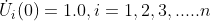
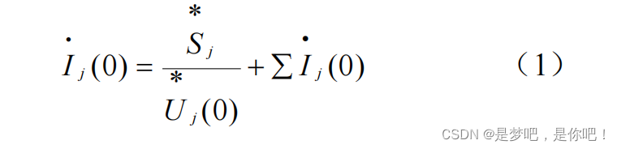
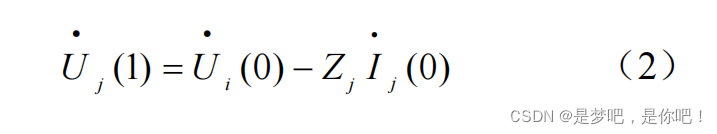
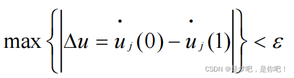
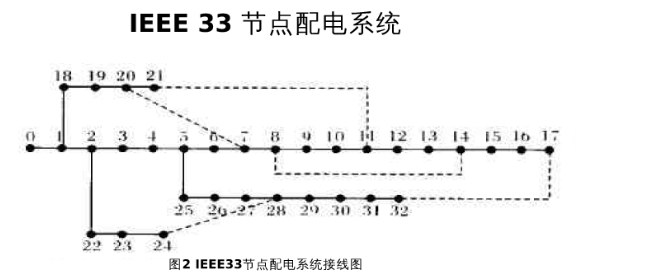
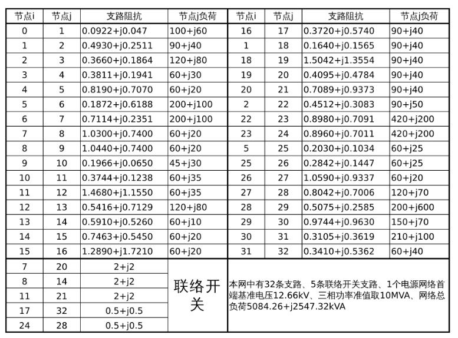
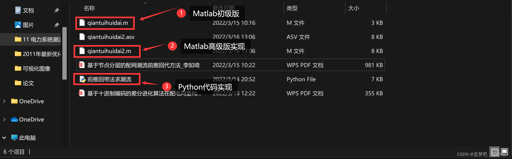

# Forward-backward method for power system flow calculation in distribution network (implemented in Python and Matlab)

Contents
1. Overview
2 Mathematical Models
3. Forward Subtransient Calculation and Steps Before Node Hierarchical Layering
3.1 Calculation Method
3.2 Calculation Steps
4 Examples and Data
5. Matlab & Python code implementation
1. Overview: The distribution network is usually connected to a single source and operates in an open loop, presenting a tree-like structure. In the analysis of distribution systems, the essence is to perform power flow calculations. The importance of trend calculation is particularly prominent in aspects such as power distribution network planning and design, power distribution network reconfiguration, and power distribution network fault analysis. Due to the operational characteristics of the distribution network, the sectional switches and tie switches on its feeders will open or close according to different situations, thereby changing the network structure and the flow direction of power. Therefore, conducting an effective and reasonable topological analysis is greatly beneficial to power flow calculation.
A new method for forward-backward power flow calculation based on node hierarchy is proposed. This method uses node hierarchy to describe the distribution network, and only requires two key auxiliary matrices for forward-backward power flow calculations, which can facilitate rapid power flow computations suitable for distribution networks with changing topologies.
2. In view of the radial characteristic of the distribution network, a node-layering method is used to describe the mathematical model. The original data of the distribution network are in the following format:
BranchM: Branch parameter matrix
{Branch connected node 1, Branch connected node 2, Branch impedance parameters} Node parameter matrix NodeM:
{Node number, Active load, Reactive load} Based on the above parameter matrix, it is easy to obtain the node-node association matrix NodeN of this structure in the distribution network during operation.
The method obtains two key matrices: the node hierarchy matrix LayerM and its corresponding upper-layer node matrix NU. The size of LayerM is determined according to the specific hierarchy, while NU is a 1×N matrix, where N is the number of nodes, with each column element representing the upper-layer node number corresponding to this column number.
3.1 Calculation Method
3.2 Calculation Steps: First step: The initial voltage at each node is set to 1, where n represents the total number of nodes in the distribution network.
Step 2: Using equations (1) and the NU matrix, calculate each branch from the last column of the node-layered matrix LayerM to the previous one.
Current.
​  
Step 3: Using equations (2) and the NU matrix, back-propagate from the first column of the node hierarchical matrix LayerM downwards to calculate the electrical potential at each node.
Press.
​  
Step Four:
​  
If the condition is not met, jump to step two for the next iteration until it is satisfied. If it is satisfied, output the result of the last voltage iteration.
Step 5: Solve the branch flow and network loss according to the requested voltage.
Detailed steps are uploaded in the appendix. 4 Examples and data: Substation voltage = 12.66kV, power base value = 10MVA
​  
​  
5. MATLAB & Python Code Implementation
​  

## Images

<!-- PAYMENT_BLOCK -->

## Get this dataset

- Payment link (Stripe): [Buy now](https://buy.stripe.com/3cs8yP7sY87d0vu9AB)
- Payment QR code: 

<!-- /PAYMENT_BLOCK -->
